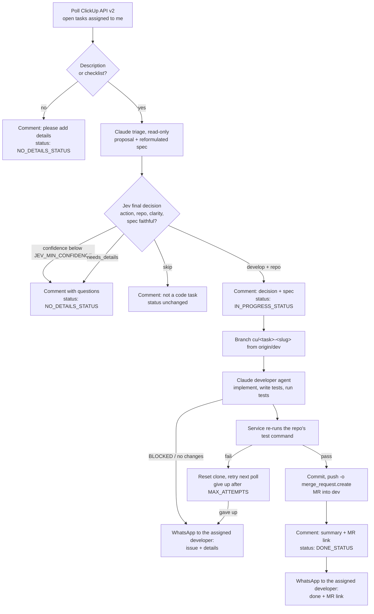

# ClickUp Dev Agent

> An AI developer for your ClickUp board: it picks up the tasks assigned to you, develops them in your codebase, and delivers each one as a merge request.


-7c3aed)


The service polls ClickUp for open tasks assigned to you and develops them with Claude Code. It works out which repository each task belongs to, then builds the feature or fix following the project's existing conventions. Before delivering anything it runs the tests to make sure the work is sound. It then opens a merge request into your integration branch, reports back on the ClickUp task, and sends a WhatsApp message to the developer the task is assigned to.

Two models split the work. **Claude Code** is the developer: it reads the code, rewrites the task as a clear spec and implements it. **Jev** ([TypeSafe AI](https://typesafe.ai/blog/introducing-system-one-models-and-jev)) is the judge: it takes the final develop / needs-details / skip decision and returns a calibrated confidence score, so uncertain tasks go back to a human instead of being guessed at.

---

## Table of contents

- [How it works](#how-it-works)
- [Guardrails](#guardrails)
- [Requirements](#requirements)
- [Quick start](#quick-start)
- [Configuration](#configuration)
- [Commands](#commands)
- [Task outcomes](#task-outcomes)
- [Project structure](#project-structure)
- [Testing](#testing)
- [Troubleshooting](#troubleshooting)
- [Security](#security)

---

## How it works



1. **Pre-filter.** A task with no description (and no checklist) gets a comment asking for details. It never reaches a model, so it costs nothing.
2. **Triage (Claude, read-only).** Claude reads the task and looks through your repositories with `Read`, `Glob` and `Grep` only. It proposes `develop`, `needs_details` or `skip` and a target repository. It also **rewrites the task as a spec** (title, goal, acceptance criteria, out of scope) that uses the real file, route and table names.
3. **Final decision (Jev).** Jev receives the task, the triage proposal and the spec as `state`, and answers four typed questions: `action` (choice), `repo` (choice), `clarity` (score) and `spec_faithful` (yes/no). Jev decides when its confidence is at least `JEV_MIN_CONFIDENCE`. Below that, the task goes back to a human. If the spec does not match the task, the developer works from the original description instead. Jev is optional: without `TYPESAFE_API_KEY`, or if Jev is down, the triage decision is final.
4. **Development (Claude).** The decision and spec are posted on the task. Then, on a fresh task branch, the developer agent implements the spec, adds a test for every acceptance criterion and runs them.
5. **Verification.** The service runs the repository's own test command independently. The work is pushed only if that command passes.
6. **Merge request.** The branch is pushed with GitLab push options, which opens a merge request into the target branch. No GitLab API token is needed.
7. **Report.** The agent's summary and the MR link are posted on the ClickUp task, and the task moves to the done status. **The assigned developer, and only them,** gets a WhatsApp message: when the task is done (with the MR link), and when something needs them (blocked, no changes, or given up after retries).

The service remembers every task it handled in `state.json`. A task runs again only if its **title or description changes**.

### What it is built on

| Layer | Used for |
|---|---|
| **Node.js 22** | Runtime with zero npm dependencies: native `fetch`, `process.loadEnvFile`, `child_process`, `node:test` |
| **ClickUp REST API v2** | `GET /team/{id}/task` (assigned tasks), `POST /task/{id}/comment`, `PUT /task/{id}` (status) |
| **Claude Code CLI** (headless) | `claude -p --output-format json --permission-mode dontAsk --allowedTools ...` for triage (read-only) and development (allowlist) |
| **Jev** (TypeSafe System One) | `POST https://api.typesafe.ai/v1/systemone` with model `jev-latest`: typed choice, score and yes/no answers with calibrated confidence |
| **Git + GitLab push options** | `git push -o merge_request.create -o merge_request.target=dev` opens the MR |
| **WhatsApp** | Twilio WhatsApp API, Meta WhatsApp Cloud API, or CallMeBot, sent only to the assigned developer |

---

## Guardrails

| Concern | How it is handled |
|---|---|
| Unreviewed code reaching `dev` | Never pushed directly. Every task becomes a **merge request** that a human reviews and merges. |
| Agent running arbitrary commands | The developer agent runs in `dontAsk` mode with an **allowlist**: file edit/search, `npm test/lint/typecheck`, `npx tsc/vitest/jest`, `git status/diff/log`. Everything else is denied. |
| Agent committing or pushing | Not allowed. Only the service commits, after its own test run passes. |
| Decision step side effects | Read-only tools only (`Read`, `Glob`, `Grep`). |
| Touching your working copy | Each repository must be a **dedicated clone**. The service refuses a dirty tree and resets the clone after every task (git-ignored files such as `.env` are kept). |
| Endless retries | Failed tasks are retried up to `MAX_ATTEMPTS`, then the error is posted on the task. |
| Vague tasks | Commented with the questions to answer, not guessed at. |
| Over-confident decisions | Jev's calibrated confidence gates every decision: below `JEV_MIN_CONFIDENCE`, a human decides. |
| Spec drift | Jev checks that the rewritten spec matches the original task. If it does not, the original task is used. |
| Silent failures | Issues reach the assigned developer on WhatsApp. A failed notification is logged and never fails the task. |
| Notification noise | WhatsApp goes only to the developer the task is assigned to, never to reporters, watchers or the rest of the team. |

---

## Requirements

- **Node.js 22+** (the service has no npm dependencies)
- **git**, with push access to your repositories
- **[Claude Code](https://docs.claude.com/en/docs/claude-code)** installed and logged in (`claude`), or an Anthropic API key
- A **ClickUp personal API token**
- Repositories hosted on **GitLab** (merge requests are opened through push options)
- Optional: a **TypeSafe API key** for Jev ([console.typesafe.ai](https://console.typesafe.ai), early access)
- Optional: a **WhatsApp** sender: Twilio, Meta WhatsApp Cloud API or CallMeBot

---

## Quick start

```bash
# 1. Get the service
git clone <this-repo-url> clickup-dev-agent
cd clickup-dev-agent

# 2. Create your local config (never committed)
cp .env.example .env
#    then fill in CLICKUP_API_TOKEN, CLICKUP_TEAM_ID and REPOS

# 3. Make a dedicated clone of each repository the agent will work on
git clone <your-frontend-repo-url> /path/to/automation/frontend
git clone <your-backend-repo-url>  /path/to/automation/backend
#    and run `npm install` in each so their tests can run

# 4. See what would happen, without side effects
npm run dry-run

# 5. Run it
npm run once     # a single pass
npm start        # keep polling
```

---

## Configuration

All settings live in `.env`. `.env.example` lists every key with a comment. **Only `.env.example` is committed.**

### ClickUp

| Key | Required | Default | Description |
|---|:---:|---|---|
| `CLICKUP_API_TOKEN` | ✅ | | Personal token: *ClickUp → Settings → Apps → API Token* |
| `CLICKUP_TEAM_ID` | ✅ | | Workspace id, the number in `app.clickup.com/<id>/…` |
| `CLICKUP_USER_ID` | | auto | Your user id. Detected from the token when empty. |
| `PICK_STATUSES` | | all open | Comma-separated statuses to pick tasks from, e.g. `to do` |
| `IN_PROGRESS_STATUS` | | | Status set while the agent works. Empty = unchanged. |
| `DONE_STATUS` | | `done` | Status set once the merge request is opened |
| `NO_DETAILS_STATUS` | | `done` | Status for tasks without details. Empty = unchanged. |
| `MIN_DESCRIPTION_LENGTH` | | `20` | Descriptions shorter than this count as "no details" |

> Status names must match the statuses of your ClickUp lists exactly (case-insensitive in ClickUp).

### Repositories and git

| Key | Required | Default | Description |
|---|:---:|---|---|
| `REPOS` | ✅ | | `name\|path\|test command` entries separated by `;` |
| `DEFAULT_REPO` | | first repo | Repository used when no tag matches |
| `GIT_REMOTE` | | `origin` | Remote to fetch from and push to |
| `GIT_TARGET_BRANCH` | | `dev` | Branch the merge requests target |
| `GIT_BRANCH_PREFIX` | | `cu/` | Prefix of the task branches |
| `GIT_AUTHOR_NAME` / `GIT_AUTHOR_EMAIL` | | repo config | Optional commit identity (same for `GIT_COMMITTER_*`) |

Example (placeholders):

```dotenv
REPOS=front|/path/to/automation/frontend|npm test;back|/path/to/automation/backend|npm test
DEFAULT_REPO=front
```

**Routing:** a task tagged `front` or `back` in ClickUp goes to the repository with that name. Otherwise it goes to `DEFAULT_REPO`. The decision step can override the choice when the task clearly belongs elsewhere.

### Claude Code

| Key | Default | Description |
|---|---|---|
| `ANTHROPIC_API_KEY` | | Optional. When empty, your logged-in Claude Code session is used. |
| `CLAUDE_BIN` | `claude` | Path to the Claude Code CLI |
| `CLAUDE_MODEL` | CLI default | Model for the developer agent |
| `CLAUDE_DECISION_MODEL` | `CLAUDE_MODEL` | Model for the decision step |
| `CLAUDE_ALLOWED_TOOLS` | safe allowlist | Comma-separated tools the developer agent may use |
| `CLAUDE_TIMEOUT_MINUTES` | `45` | Maximum time for one development run |
| `CLAUDE_DECISION_TIMEOUT_MINUTES` | `10` | Maximum time for one decision run |
| `TEST_TIMEOUT_MINUTES` | `15` | Maximum time for the verification test run |

### Jev (optional)

| Key | Default | Description |
|---|---|---|
| `TYPESAFE_API_KEY` | | TypeSafe API key. Empty = Jev off, and the triage decision is final. |
| `JEV_MODEL` | `jev-latest` | Jev model or alias |
| `JEV_MIN_CONFIDENCE` | `0.7` | Below this, the task goes back to a human (needs details) |

### WhatsApp notifications (optional)

Messages go **only to the assigned developer**. The service handles only the tasks assigned to the ClickUp token's user, and `WHATSAPP_TO` is that developer's number. Reporters, watchers and the rest of the team are never messaged.

| Key | Default | Description |
|---|---|---|
| `WHATSAPP_PROVIDER` | | `twilio`, `meta` or `callmebot`. Empty = notifications off. |
| `WHATSAPP_TO` | | The assigned developer's number in international format, e.g. `+2126XXXXXXXX` |
| `WHATSAPP_EVENTS` | `done,error,blocked,no-changes` | Outcomes that notify the developer (any from [Task outcomes](#task-outcomes)) |
| `TWILIO_ACCOUNT_SID` / `TWILIO_AUTH_TOKEN` / `TWILIO_WHATSAPP_FROM` | | For `twilio` (sandbox or approved sender) |
| `META_WHATSAPP_TOKEN` / `META_WHATSAPP_PHONE_ID` | | For `meta`. Free-form text is only delivered within the 24-hour customer-service window. |
| `CALLMEBOT_API_KEY` | | For `callmebot`: free, personal use. Get a key by messaging their bot. |

Example message:

```
✅ ClickUp Dev Agent: DONE
[CU-86ab12] Add pagination to GET /orders

Repo: api · cu/86ab12-add-pagination-to-get-orders (a1f9c3e)
MR: https://gitlab.com/<group>/api/-/merge_requests/128

https://app.clickup.com/t/86ab12
```

### Service

| Key | Default | Description |
|---|---|---|
| `POLL_INTERVAL_SECONDS` | `300` | Delay between two polls |
| `MAX_ATTEMPTS` | `2` | Failed attempts per task before giving up |

---

## Commands

| Command | What it does |
|---|---|
| `npm start` | Polls forever. `Ctrl+C` stops after the current task (press twice to force). |
| `npm run once` | One polling pass, then exits. Handy for a cron job or scheduled task. |
| `npm run dry-run` | Lists tasks and what would happen. No Claude runs, comments or git operations. |
| `npm test` | Runs the test suite |

---

## Task outcomes

Recorded per task in `state.json` (git-ignored):

| Outcome | ClickUp comment | Status change | Retried when |
|---|---|---|---|
| `no-details` | asks for details | `NO_DETAILS_STATUS` | the task is edited |
| `needs-details` | questions from the decision step | `NO_DETAILS_STATUS` | the task is edited |
| `skipped` | reason it is not a code task | none | the task is edited |
| `blocked` | agent's reason and questions | none | the task is edited |
| `no-changes` | agent's summary | none | the task is edited |
| `done` | summary + merge request link | `DONE_STATUS` | the task is edited |
| `error` | posted after the last attempt | none | next poll, up to `MAX_ATTEMPTS` |

To force a task to run again, delete its entry from `state.json`.

---

## Project structure

```
clickup-dev-agent/
├── src/
│   ├── index.js     # entry point: polling loop, --once / --dry-run, graceful stop
│   ├── worker.js    # per-task flow: pre-filter → triage → Jev → develop → MR → report
│   ├── jev.js       # Jev final decision (TypeSafe API) + confidence gating
│   ├── notify.js    # WhatsApp to the assigned developer (Twilio / Meta / CallMeBot)
│   ├── task.js      # prompts, decision parsing, routing, branch names, fingerprints
│   ├── agent.js     # Claude Code headless runs + verification test run
│   ├── git.js       # task branch, cleanup, commit + push with MR options
│   ├── clickup.js   # minimal ClickUp API v2 client
│   ├── config.js    # .env loading and validation
│   ├── state.js     # state.json persistence
│   └── proc.js      # child process helper with timeouts
├── test/            # node:test suites
├── .env.example     # every setting, documented (copy to .env)
└── package.json
```

---

## Testing

```bash
npm test
```

- **task / config:** routing, branch naming, decision parsing, config validation
- **clickup:** the client against a local mock HTTP server (auth header, paging, comments, statuses)
- **worker:** every outcome path, with ClickUp, Claude, Jev and git faked
- **jev:** request shape against the documented TypeSafe API, 429/529 retry, confidence gating, spec rejection
- **notify:** Twilio, Meta and CallMeBot request shapes, muted events, provider errors never thrown
- **git:** the real branch → push-with-MR-options → cleanup flow against a local bare repository, checking that the target branch is never pushed to directly

The tests never call ClickUp, Claude, Jev or WhatsApp.

---

## Troubleshooting

| Symptom | Fix |
|---|---|
| `Missing in .env: …` | Copy `.env.example` to `.env` and fill in the listed keys. |
| `ClickUp … -> 401` | Invalid or expired `CLICKUP_API_TOKEN`. |
| `ClickUp … -> 400` when setting a status | The status name does not exist in that list. Check `DONE_STATUS` / `IN_PROGRESS_STATUS`. |
| `has uncommitted changes` | `REPOS` points at a working copy. Use a dedicated clean clone. |
| No merge request link in the comment | The remote is not GitLab, or push options are disabled. The branch is still pushed, so open the MR manually. |
| `Jev -> 401` | Invalid `TYPESAFE_API_KEY`. The service keeps going on the triage decision. |
| No WhatsApp message | Check `WHATSAPP_EVENTS` and the logs (`WhatsApp notification failed: ...`). With Meta, the 24-hour window may have expired. |
| `Claude Code exited …` | Run `claude` once interactively to log in, or set `ANTHROPIC_API_KEY`. |
| Tasks are never picked | Check `PICK_STATUSES` and that the tasks are assigned to the token's user. |

---

## Security

- **Never commit `.env`.** It is in `.gitignore`. Only `.env.example`, which has empty values, belongs in the repository.
- Use a ClickUp token that belongs to the account the tasks are assigned to, and rotate it if it leaks.
- The agent works from task descriptions, so only point the service at workspaces whose authors you trust. Merge-request review is the final safety net: always review before merging.
- Every Claude run is billed to your Claude Code account or API key. Empty tasks never reach a model, and triage plus Jev stop out-of-scope or vague tasks before the more expensive development run. Jev is billed per input token by TypeSafe.
- TypeSafe and WhatsApp keys live in `.env` like every other secret.
